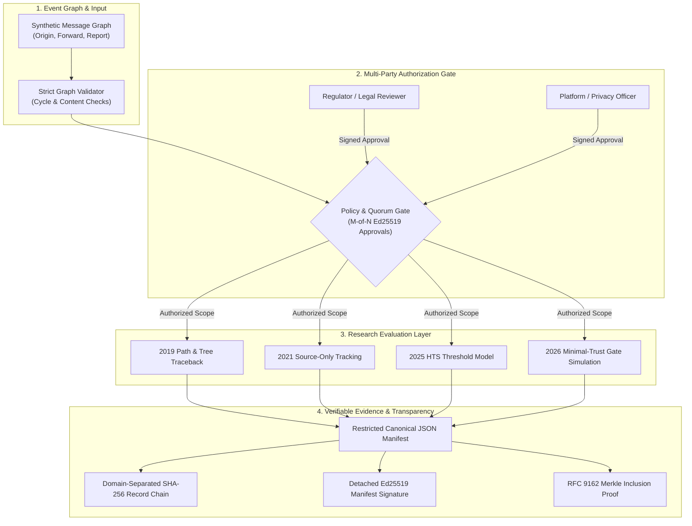

# WhatsApp Traceability Research Lab

[](https://github.com/AmithKumar1/whatsapp-traceability-research/releases) [](https://github.com/AmithKumar1/whatsapp-traceability-research/actions/workflows/ci.yml) [](pyproject.toml) [](LICENSE) [](#)

> **An independent evaluation and benchmark harness for privacy-preserving source tracing in end-to-end encrypted (E2EE) messaging.**

[Overview](#overview) • [Why This Exists](#why-this-project-exists) • [Architecture](#architecture) • [Quick Start](#quick-start) • [Protocol Comparison](#protocol-comparison) • [Core Capabilities](#core-capabilities) • [Principles](#project-principles) • [Docs](#repository-map)

---

> [!IMPORTANT]
> **Independent Research & Scope Limits**
> This is an independent academic and open-source evaluation framework. It is **not affiliated with, endorsed by, or operated by WhatsApp or Meta**.
> - **Synthetic only:** Executable demonstrations evaluate conceptual models on synthetic event graphs; they do not contact WhatsApp servers or access private chats.
> - **No backdoor or decryption:** Does not weaken end-to-end encryption, bypass cryptographic backups, or reconstruct unrecorded forwarding events.
> - **Governance over technology:** Technical checks enforce configured technical policies; real evidence requires authentic legal authority.

<details>
<summary>📦 <b>Package & CLI Compatibility Note</b> (<code>e2ee-traceability-lab</code> / <code>opentrace</code>)</summary>

- **Installed CLI command:** `e2ee-traceability` (preferred) or legacy console alias `opentrace`.
- **PyPI / Distribution name:** `e2ee-traceability-lab`.
- **Python import module:** `opentrace` (`python -m opentrace ...`).
- Wire format identifiers, schemas, and domain-separation tags retain the `opentrace` prefix for v0.x protocol compatibility.
</details>

## Overview

WhatsApp Traceability Research Lab provides an empirical, reproducible testbed to analyze, benchmark, and compare distinct cryptographic and policy proposals for source tracing in E2EE networks. Rather than treating "traceability" as a monolithic concept, the lab isolates distinct research designs behind standardized adapters to evaluate:

1. **Information disclosure**: Does a scheme reveal only the source account, the full forwarding path, or the entire viral tree?
2. **Abuse resistance & multi-party control**: Can an adversary or rogue platform trace an innocent forwarder without multi-party quorum?
3. **Evidence provenance**: Can an offline bundle be verified with strict canonical manifests, domain-separated hash chains, and RFC 9162 Merkle proofs?

## Why this project exists

There is no single "traceability algorithm"—different academic papers propose fundamentally different trust models, disclosure boundaries, and cryptographic assumptions:

| Protocol Family | Capability & Scope | Research Reference | Adapter Status |
| :--- | :--- | :--- | :--- |
| 🌲 **Path / Tree Traceback** | Discloses complete message paths or branching trees upon recipient complaint | Tyagi, Miers & Ristenpart (*CCS 2019*) | **Cryptographic reproduction** (HMAC-SHA256 mid, AES-CTR pointers, RecMsg verification, optional PKI extension) + synthetic tree adapter |
| 🎯 **Complaint-Enabled Tracking** | Identifies original sender while limiting intermediate recipient disclosure | Peale, Eskandarian & Boneh (*CCS 2021*) | Synthetic source-only adapter |
| ⏳ **Hop Tracking Signatures (HTS)** | Traces originators after long forwarding paths with configurable anonymity thresholds | Branco et al. (*ePrint 2025/1052*) | Synthetic threshold model |
| 🏛️ **Minimal-Trust Tracing** | Distributes tracing power across platform, regulator, moderators, and recipients | Wang et al. (*NDSS 2026*) | Synthetic policy-gate model |

The framework focuses on **reproducible benchmarking, policy modeling, evidence packaging, adversarial testing, and comparative trade-off analysis**.

## Architecture

The framework unifies graph generation, multi-party authorization, adapter execution, and integrity verification into a single verifiable pipeline:



## Quick start

Requires Python 3.11+.

### 1. Installation

```bash
python -m venv .venv

# Windows PowerShell:
.venv\Scripts\Activate.ps1
# macOS/Linux:
source .venv/bin/activate

python -m pip install -e ".[dev]"
```

*(Or run directly with `PYTHONPATH=src` without installing: see [Direct Module Execution](#direct-module-execution).)*

### 2. Generate and verify a synthetic evidence case

```bash
# 1. Create a synthetic branching forwarding bundle
e2ee-traceability demo --out ./artifacts/demo-case

# 2. Independently verify the manifest signature, SHA-256 record chain, and file inventory
e2ee-traceability verify ./artifacts/demo-case
```

To verify against an explicitly trusted external public key:
```bash
e2ee-traceability verify ./artifacts/demo-case --public-key ./trusted-signer.pem
```

### 3. Multi-party authorization check

```bash
# Generate a sample request with multi-domain Ed25519 reviewer approvals
e2ee-traceability authorization-demo --out ./artifacts/authorization-demo

# Verify request scope, distinct reviewer domains, role policy, and timestamp freshness
e2ee-traceability authorize-check   --request ./artifacts/authorization-demo/request.json   --approvals ./artifacts/authorization-demo/approvals.json   --trust ./artifacts/authorization-demo/trust-registry.json   --policy ./artifacts/authorization-demo/policy.json
```

### 4. Merkle inclusion proofs

```bash
# Generate an offline inclusion proof
e2ee-traceability merkle-demo --out ./artifacts/merkle-proof.json

# Independently verify leaf inclusion against the root
e2ee-traceability merkle-verify --proof ./artifacts/merkle-proof.json --entry-text synthetic-event-002

# Run the Merkle microbenchmark
python benchmarks/benchmark_merkle.py --sizes 10 100 1000 --repeats 5 --out ./artifacts/merkle-benchmark.json
```

### 5. Cryptographic traceback reproduction (Tyagi et al. CCS 2019)

Offline cryptographic experiment reproducing the symmetric Path Traceback scheme (Section 4 / Figure 3) with recipient-side RecMsg verification, loop detection, and an optional PKI-backed non-repudiation extension:

```bash
# Execute offline cryptographic experiment (4 hops, HMAC-SHA256 mid, AES-CTR pointers, RecMsg verification)
e2ee-traceability traceback-reproduction --hops 4 --out ./artifacts/exp-tyagi2019.json --markdown ./artifacts/exp-tyagi2019.md

# Evaluate adversarial scenarios (tampered message, uncertified key spoofing, broken chain, forwarding cycle)
e2ee-traceability traceback-reproduction --hops 4 --scenario tampered_content --adversarial-hop 2
e2ee-traceability traceback-reproduction --hops 4 --scenario forged_signature --adversarial-hop 2
e2ee-traceability traceback-reproduction --hops 4 --scenario missing_hop --adversarial-hop 2
e2ee-traceability traceback-reproduction --hops 4 --scenario cyclic_forwarding --adversarial-hop 2
```

For formal security definitions (CCS 2019 Theorem 1 Platform Trace Confidentiality, Theorem 2 User Trace Confidentiality, and Theorem 3 Trace Unforgeability), threat models, and claim-to-code mapping, see [docs/REPRODUCING_TYAGI2019.md](docs/REPRODUCING_TYAGI2019.md).

### 6. Run tests

```bash
pytest
```

### Direct module execution

If running from source without an active editable install:

```bash
# macOS/Linux:
PYTHONPATH=src python -m opentrace demo --out ./artifacts/demo-case
PYTHONPATH=src python -m opentrace verify ./artifacts/demo-case

# Windows PowerShell:
$env:PYTHONPATH = "src"
python -m opentrace demo --out ./artifacts/demo-case
python -m opentrace verify ./artifacts/demo-case
```

## Protocol comparison

Compare five synthetic research models in a single controlled benchmark:

```bash
e2ee-traceability compare \
  --message-size 256 \
  --hops 8 \
  --tree-depth 3 \
  --branching-factor 2 \
  --repeats 5 \
  --hts-anonymity-threshold-hops 2 \
  --hts-trace-threshold-hops 4 \
  --out artifacts/protocol-comparison.json \
  --markdown artifacts/protocol-comparison.md
```

This evaluates:
- **Disclosed forwarders**: Whether intermediate forwarders remain confidential or are leaked in whole/part.
- **Reporting requirements**: User complaint receipts vs. unsolicited platform queries.
- **Timing & payload bounds**: Empirical execution times and didactic payload size proxies.
- **Collusion resistance**: Single-honest-party scenarios in distributed policy models.

Explore individual research models:
```bash
# Hop Tracking Signatures threshold model
e2ee-traceability hts2025-demo --hops 8 --anonymity-threshold-hops 2 --trace-threshold-hops 4

# Minimal-trust multi-party policy simulation
e2ee-traceability minimal-trust2026-demo --required-reports 3

# Synthetic tree traceback demo
e2ee-traceability traceback2019-tree-demo
```

Sample outputs are available in [`examples/protocol-comparison-sample-v0.6.0.json`](examples/protocol-comparison-sample-v0.6.0.json) and [`examples/protocol-comparison-sample-v0.6.0.md`](examples/protocol-comparison-sample-v0.6.0.md).

## Core capabilities

- 🛡️ **Evidence Manifest v0.2:** Hashes file content and size, links records with a domain-separated SHA-256 chain, signs a restricted canonical-JSON manifest with Ed25519, and verifies bundle inventory completeness.
- ⚖️ **M-of-N Authorization Envelope:** Policy-bound Ed25519 approvals enforcing distinct trust domains, role definitions, validity windows, and explicit disclosure-mode policy gates.
- 🌳 **Offline Merkle Proofs:** Creates and verifies offline Merkle inclusion proofs using RFC 9162 domain separation (leaf `0x00`, node `0x01`) and range-based tree hashing.
- 📊 **Unified Synthetic Benchmark:** Shared measurement schema recording construction and trace timings, node disclosure fractions, memory entries, and output size proxies.
- 🔬 **Strict Epistemic Discipline:** Distinguishes observed platform data, cryptographic proofs, and probabilistic inferences. Rejects duplicate JSON keys, floating-point ambiguity, and graph cycles.
- 🎯 **Explicit Disclosure Modes:** `ORIGIN_ONLY` is default. Full `PATH` and `TREE` fixtures require separate explicit authorization.

## Project principles

1. **First originator is not necessarily a named human.** An account credential, cryptographic key, phone binding, and real-world person are distinct claims.
2. **First-originator mode is the default.** Full path and forwarding tree disclosures are intrusive modes requiring separate, explicit authorization.
3. **No evidence, no claim.** Every finding must link to cryptographic evidence, an audit trail, and stated epistemic limitations.
4. **Observed ≠ verified ≠ inferred.** Reports assign explicit evidentiary classes to prevent misinterpreting raw inputs as verified facts.
5. **No private history lookups.** Adapters process only supplied, lawfully acquired artifacts; they do not query accounts by phone number.
6. **Cryptography is not a substitute for governance.** Multi-party authorization, scope minimization, and independent audit are mandatory design surfaces.
7. **No home-grown primitives.** Production cryptographic algorithms reuse vetted libraries (`cryptography`); research algorithms remain cleanly isolated in adapters.
8. **Do not overclaim timestamps.** Device clocks, server receipt logs, and trusted timestamp tokens (RFC 3161) represent different trust tiers.
9. **No mandatory blockchain.** Lightweight signed manifests and append-only transparency trees provide portable verification without distributed ledger overhead.
10. **Research isolation.** Protocol adapters are research models and must not be treated as production implementations until independently audited.

## Repository map

```text
├── docs/                      # Architectural specifications and threat models
│   ├── MASTER_SPEC.md         # Comprehensive system specification
│   ├── REPRODUCING_TYAGI2019.md # Cryptographic reproduction and security definitions
│   ├── RESEARCH_REVIEW.md     # Analysis of CCS 2019, CCS 2021, HTS 2025, NDSS 2026
│   ├── THREAT_MODEL.md        # Adversarial assumptions and boundaries
│   ├── PROTOCOL_COMPARISON.md # Benchmark comparison methodology
│   └── ROADMAP.md             # Implementation milestones (P0 to P5)
├── schemas/                   # Draft 2020-12 JSON Schemas for all formats
│   ├── case-manifest.schema.json
│   ├── traceback-experiment.schema.json
│   ├── authorization-request.schema.json
│   ├── protocol-comparison.schema.json
│   └── merkle-inclusion-proof.schema.json
├── src/opentrace/             # Core library and CLI implementation
│   ├── canonical.py           # Restricted canonical JSON serializer
│   ├── integrity.py           # Manifest creation and verification
│   ├── authorization.py       # Multi-party approval verification
│   ├── transparency.py        # RFC 9162 offline Merkle inclusion proofs
│   ├── tracegraph.py          # Synthetic forwarding graph validator
│   └── protocols/             # Research scheme adapters (2019, 2021, 2025, 2026)
├── tests/                     # 80+ unit tests with full cross-platform coverage
└── benchmarks/                # Reproducible microbenchmarks
```

## Security reporting

If you discover a security vulnerability or private data exposure risk, please review [`SECURITY.md`](SECURITY.md) for responsible disclosure guidelines. Do not report security vulnerabilities in public GitHub issues.

## Citation

```bibtex
@software{whatsapp_traceability_research_lab_2026,
  author = {WhatsApp Traceability Research Lab contributors},
  title = {WhatsApp Traceability Research Lab: Independent Research and Evaluation Framework for E2EE Traceability},
  year = {2026},
  url = {https://github.com/AmithKumar1/whatsapp-traceability-research},
  version = {0.6.0}
}
```
